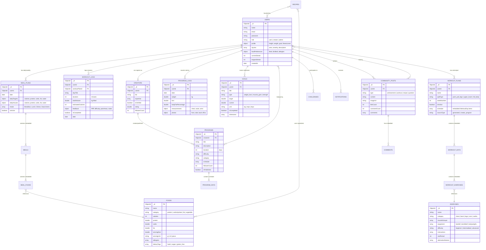
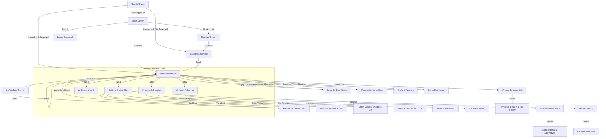

# 🗄️ BodyPilot — Database Schema & UI Wireframe Specification

---

## 1. 📊 Entity-Relationship (ER) Schema Diagram

---

## 2. 🏛️ Schema Entity Descriptions & Relationships

| Collection / Entity | Key Type | Purpose & Cardinality |
| :--- | :--- | :--- |
| **`USERS`** | Primary (`_id`) | Central user account containing personal demographics, active fitness goals, injury safety limits, and food preferences. Root for all user relations (1:N). |
| **`WORKOUT_PLANS`** | Primary (`_id`), FK (`userId`) | Active 7-day personalized workout schedule containing embedded `WorkoutDay` and `WorkoutExercise` documents. Supports dynamic adaptation history. |
| **`EXERCISES`** | Primary (`_id`) | Global catalog of 111+ exercises with target muscle groups, difficulty, required equipment, and safe alternatives. |
| **`WORKOUT_LOGS`** | Primary (`_id`), FK (`userId`, `workoutPlanId`) | Immutable historical log of completed workouts, volume calculated (kg), duration, and RPE feedback for adaptive overload. |
| **`FOODS`** | Primary (`_id`) | Global nutrition database of 135+ items with exact macro breakdowns (calories, protein, carbs, fats per serving) and allergen tags. |
| **`MEAL_PLANS`** | Primary (`_id`), FK (`userId`) | Daily/weekly nutrition plan with target vs. actual calories/macros and embedded meal items (Breakfast, Lunch, Dinner, Snacks). |
| **`RECIPES`** | Primary (`_id`), FK (`createdBy`) | Healthy culinary database referencing required food ingredients and step-by-step preparation instructions. |
| **`PROGRESS_LOGS`** | Primary (`_id`), FK (`userId`) | Time-series progression tracking bodyweight, BMI, body fat percentage, body circumference measurements, and photo links. |
| **`GOALS`** | Primary (`_id`), FK (`userId`) | Milestone-based targets (e.g., *Bench 100kg*, *Reach 75kg*) with live percentage completion calculations. |
| **`CREATORS`** | Primary (`_id`), FK (`userId`) | Coach and trainer profiles with verified badges, ratings, and follower counts. |
| **`PROGRAMS`** | Primary (`_id`), FK (`creatorId`) | Multi-week structured training regimens designed by coaches with a **1-Tap Follow** feature to adopt as the active user plan. |
| **`COMMUNITY_POSTS`**| Primary (`_id`), FK (`userId`) | Social feed entries for achievements, workout milestones, and tips with likes and embedded comments. |

---

## 3. 📱 Application Screen Navigation Map

